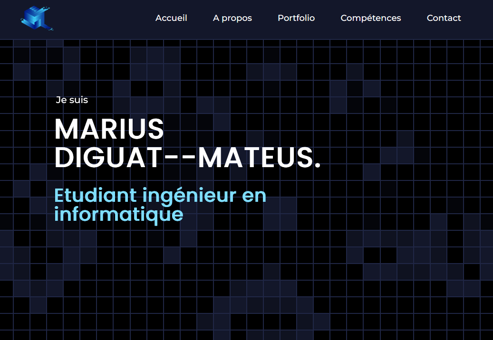

# Portfolio (previous version)

The previous personal portfolio of Marius Diguat--Mateus, a static website written in HTML, CSS and TypeScript while he was an engineering student at UTBM.

> This is an archived version. The current portfolio is at **https://www.mariuscode.com**.



## What it does

- Home page whose background is Conway's Game of Life, with a speed slider.
- About section with studies, internships and freelance work.
- Project section with screenshots, descriptions and the stack used for each project, filterable by category.
- Skills section and contact links.

## Tech stack

HTML, CSS, TypeScript compiled to plain JavaScript. No framework or build step.

## Run it locally

Open `index.html` in a browser, or serve the folder:

```bash
python3 -m http.server 8000
```

The archived site is also published with GitHub Pages: https://mariusfaitducode.github.io/Portfolio/

## Context

Built by Marius Diguat--Mateus in 2023 and redesigned in March 2024 (third version). Replaced by https://www.mariuscode.com.
